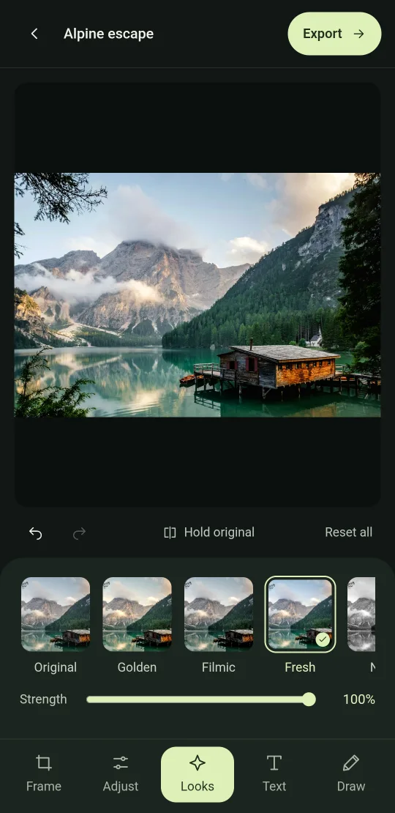
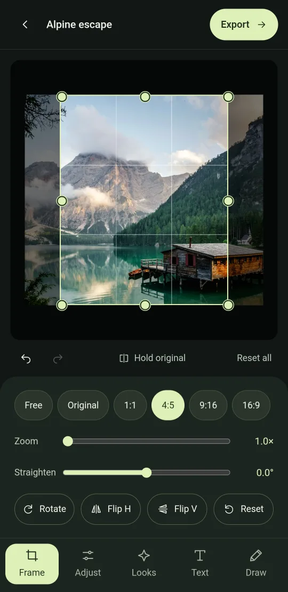
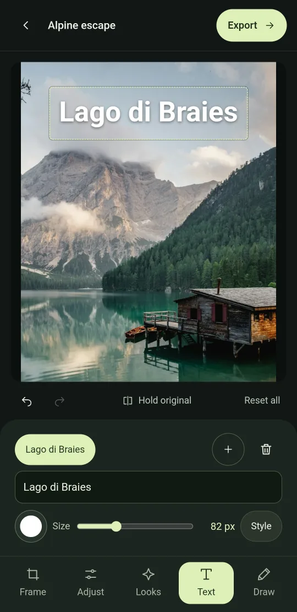
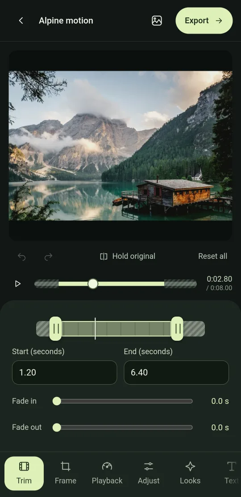
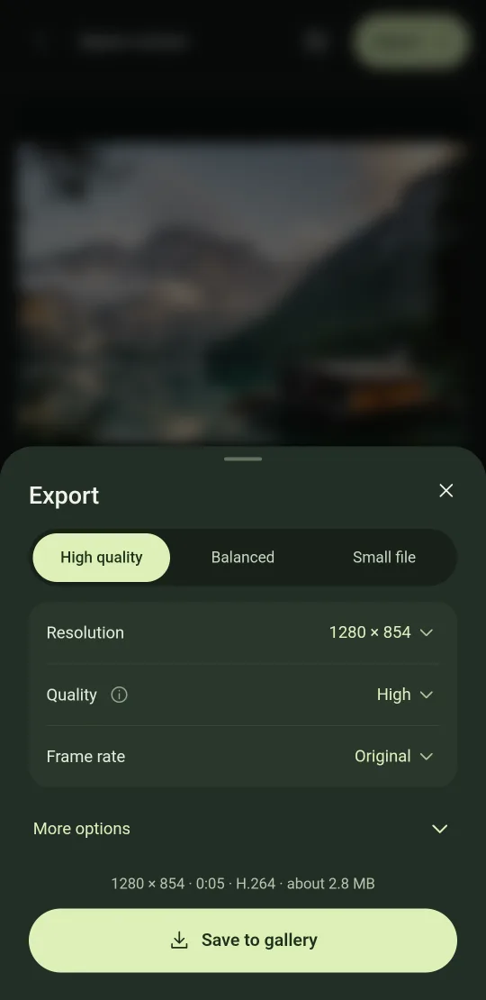

# Luma Studio

A photo and video editor for Android 10 and newer.

## Install

Download `luma-studio.apk` from [Releases](https://github.com/dotcomdomain/luma-studio/releases) on the phone and open it. New versions install over old ones and keep your projects.

## Features

- **Photos and videos:** looks with a strength slider, adjustments (brightness, contrast, saturation, warmth, shadows, highlights, vignette), crop, straighten, rotate, flip, text and drawing layers.
- **Videos also get:** trim, fades, speed from 0.5× to 2× with pitch kept, volume, timing for each text and drawing layer, and saving any frame as a photo.
- **Frame:** drag an edge to crop and the view zooms in when you let go. Drag the edge back out to undo the crop.
- **Export:** JPEG, PNG or WebP for photos. H.264 or HEVC with AAC sound for videos, which keep exporting in the background. You get three presets; High quality is the default.
- **Projects:** the last six stay under Recent with their edits. Luma edits a copy, so originals are never changed.

## Build

Run `./build.sh` in Termux. It needs a JDK, the Android 36 platform, aapt2, d8 and apksigner, and no Gradle. The APK lands in `artifacts/luma-studio.apk`.

The app is a WebView UI (`app/assets`) with a Java side (`app/src/studio/luma`) for importing, saving and video export. Video export uses MediaCodec and OpenGL, and the shader matches the preview's colour and frame timing.

## Development

- `scripts/dev.sh` builds, installs and runs Luma on a hidden virtual display, and evaluates JS in it through WebView DevTools.
- `scripts/dev.sh clones t1` installs a test copy with its own data. It doesn't appear in the launcher or the share menu.
- `scripts/test-helpers.sh` adds helpers for taps, screenshots and DevTools commands.
- `scripts/compare-export.sh` compares the newest export with the preview, block by block.
- `scripts/SetDefaultEditor.java` makes Luma the "Always" app for gallery Edit buttons (needs root).

## Credits

The sample photo is from [Unsplash](https://images.unsplash.com/photo-1470770841072-f978cf4d019e); the sample clip is made from it. Icons are hand-drawn SVG.
